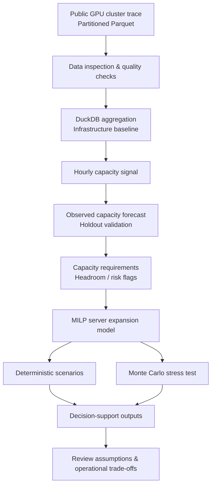

# Capacity Planning & Optimisation Engine

<p align="center">
  <strong>A reproducible industrial-engineering analytics project for infrastructure capacity forecasting, constrained expansion planning, and operational risk simulation.</strong>
</p>

<p align="center">
  
  
  
  
  
</p>

## Project at a glance

Capacity decisions are difficult when infrastructure is expensive, the observed footprint changes over time, and operational headroom matters. This project brings together data engineering, forecasting, industrial engineering and operations research in a transparent decision-support workflow.

The current implementation uses the **Alibaba GPU Cluster Trace 2026** as a public case study. It builds an infrastructure baseline, creates an hourly capacity signal, evaluates a seasonal-naive forecast of the observed GPU capacity footprint, translates that forecast into planning requirements, solves an integer server-addition model, and stress-tests the resulting plan.

> **Scope and honesty:** the implemented forecast targets observed GPU inventory/capacity, not workload demand or utilisation. Capacity factors, server capacity and cost coefficients used by the planning/optimisation model are assumptions that must be calibrated for a real operating environment. The repository does not claim realised cost, energy or carbon savings.

## What the engine does

| Workstream | Approach | Decision-support output |
|---|---|---|
| Data engineering | DuckDB + partitioned Parquet; schema and data-quality checks | Compact hourly infrastructure aggregates |
| Capacity signal | Server-hour GPU/CPU inventory aggregation | Observed infrastructure footprint |
| Forecasting | 24-hour seasonal-naive benchmark of observed GPU capacity with chronological holdout | Capacity forecast, validation MAE/RMSE and summary |
| Capacity planning | Target utilisation, usable-capacity factor and safety buffer | Required capacity, headroom and risk flags |
| Optimisation | Mixed-integer linear programming (PuLP/CBC) | Period-by-period server additions and modelled cost |
| Risk analysis | Deterministic stress cases and seeded Monte Carlo simulation | Shortage exposure and percentile summaries |

## Architecture



## Terminology and architecture decisions

Use the [project glossary](docs/GLOSSARY.md) for consistent definitions of the capacity signal, forecast target, headroom, planning assumptions and optimisation terms. The [architecture decision record](docs/ADR-001-ANALYTICAL-STACK.md) explains the rationale and trade-offs behind the Python, DuckDB, Parquet and MILP stack.

## Repository structure

```text
.
├── docs/
│   ├── EXECUTIVE_SUMMARY.md
│   ├── LAYER1_LAYER2_ANALYTICAL_PLAN.md
│   ├── POD_DATASET_PLAYBOOK.md
│   ├── DATA_DICTIONARY_TEMPLATE.md
│   ├── MODEL_ASSUMPTIONS.md
│   ├── GLOSSARY.md
│   ├── ADR-001-ANALYTICAL-STACK.md
│   ├── VALIDATION_AND_LIMITATIONS.md
│   ├── LINKEDIN_SHOWCASE.md
│   └── RUN_MANIFEST_TEMPLATE.json
├── notebooks/                 # Staged analytical walkthrough
├── scripts/                   # Parquet inspection and DuckDB aggregation
├── sql/                       # Data-quality and exploratory SQL
├── src/cpoe/
│   ├── capacity/               # Capacity requirements and risk flags
│   ├── data/                   # Loading and validation
│   ├── forecasting/            # Forecast pipeline and models
│   ├── optimization/           # MILP capacity expansion
│   ├── simulation/             # Deterministic and Monte Carlo scenarios
│   └── run_pipeline.py         # End-to-end orchestration
├── tests/
├── pyproject.toml
└── requirements.txt
```

## Quick start

### 1. Create an environment

Python 3.10 or newer is required. A clean virtual environment is recommended.

**macOS / Linux**
```bash
python3 -m venv .venv
source .venv/bin/activate
python -m pip install --upgrade pip
python -m pip install -e ".[dev]"
```

**Windows PowerShell**
```powershell
py -3 -m venv .venv
.\.venv\Scripts\Activate.ps1
python -m pip install --upgrade pip
python -m pip install -e ".[dev]"
```

### 2. Obtain and inspect the data

The project uses the public [Alibaba GPU Cluster Trace 2026](https://github.com/alibaba/clusterdata/tree/master/cluster-trace-gpu-v2026). Read the official [schema](https://github.com/alibaba/clusterdata/blob/master/cluster-trace-gpu-v2026/docs/schema.md) and [download guide](https://github.com/alibaba/clusterdata/blob/master/cluster-trace-gpu-v2026/docs/data_download.md) before processing.

Start with the server-hourly dataset. Keep raw partitions outside version control, under:

```text
data/RAW/asi_opensource_server_hourly/
```

Inspect the actual fields before aggregation:

```bash
python scripts/inspect_parquet_dataset.py --path "data/RAW/asi_opensource_server_hourly/**/*.parquet"
```

The Layer 1 aggregation script uses DuckDB and a configurable Parquet glob:

**macOS / Linux**
```bash
export SERVER_PARQUET_GLOB="data/RAW/asi_opensource_server_hourly/**/*.parquet"
python scripts/build_layer1_server_baseline.py
```

**Windows PowerShell**
```powershell
$env:SERVER_PARQUET_GLOB = "data/RAW/asi_opensource_server_hourly/**/*.parquet"
python scripts/build_layer1_server_baseline.py
```

The pod-hourly archive is very large (the release guide has listed approximately 352 GB compressed). Review [the staged processing playbook](docs/POD_DATASET_PLAYBOOK.md), check local disk capacity, and pilot a narrow partition range before scaling. Do not download or process the full archive by default.

### 3. Configure the engine input

The current Python pipeline reads a local DuckDB database at `data/source.duckdb` and expects a table/view named `asi_opensource_server_hourly`. Create that database/view from the validated source data or adapt `src/cpoe/config.py` and the loader to your chosen location.

Run the environment check:

```bash
python scripts/check_environment.py
```

### 4. Run tests and the pipeline

```bash
pytest
python -m cpoe.run_pipeline
```

The pipeline writes reproducible CSV outputs under `data/processed/` (ignored by Git), including `capacity_forecast.csv`, forecast validation, capacity requirements, the optimisation solution, deterministic scenarios and the Monte Carlo risk summary.

## Model assumptions

The project intentionally exposes key assumptions instead of presenting them as measured facts. Current examples include:

- Target utilisation: 70%.
- Usable capacity factor: 90%.
- Safety buffer: 10%.
- GPUs per new server: 8.
- Optimisation server capacity: 8 capacity units per server.
- Illustrative server CAPEX: 1,000,000 cost units.
- Illustrative per-period OPEX: 1,000 cost units.
- Illustrative shortage penalty: 10,000,000 cost units.
- Monte Carlo required-capacity stress multiplier: Normal(1.0, 0.08), truncated at zero.
- Monte Carlo capacity-availability multiplier: Uniform(0.85, 1.0).

These are model inputs for sensitivity analysis, **not supplier quotations, observed costs, service-level commitments or empirically estimated distributions**. See [MODEL_ASSUMPTIONS.md](docs/MODEL_ASSUMPTIONS.md).

## Interpretation guardrails

- `day` and `hour` are relative trace partitions, not real calendar timestamps.
- Server inventory is an observed footprint, not proof every GPU is operational, schedulable or available.
- The implemented forecast is of observed capacity/inventory. It is not a demand or utilisation forecast.
- Resource requests and utilisation are not equivalent to electrical power draw.
- A shortage probability from Monte Carlo is conditional on the specified required-capacity stress and capacity-availability assumptions; it is not a measured failure probability.
- No actual business savings, energy savings or carbon reductions are claimed.
- Do not add raw datasets, large derived files, credentials or employer-confidential information to this repository.

## Roadmap

- [ ] Add a reproducible, small synthetic fixture so the end-to-end pipeline can be run without the large source trace.
- [ ] Separate inventory forecasting from true workload-demand forecasting.
- [ ] Compare forecasts against persistence and seasonal-naive baselines on rolling chronological holdouts.
- [ ] Add GPU-model compatibility and workload priority constraints to optimisation where source fields support them.
- [ ] Add parameterised sensitivity analysis for CAPEX, OPEX, capacity and shortage penalties.
- [ ] Add CI for tests, linting and notebook validation.
- [ ] Publish charts and a run manifest generated from an executed, validated run.
- [ ] Add energy analysis only after introducing defensible measured or calibrated power inputs.

## Why this project matters

The aim is not to produce a forecast in isolation. It is to connect data quality, capacity signals, operational buffers, constrained investment decisions and uncertainty into a workflow that helps explain **what capacity may be required, when expansion could be needed, and how sensitive that decision is to assumptions**.

## Author

**Nnabundom “Kelly” Raji, PMP, MSc**  
Industrial Engineering | Strategic Capacity Planning | Data Analytics

[GitHub profile](https://github.com/kellyraji) · [Repository](https://github.com/kellyraji/capacity-planning-optimization-engine)

## References

- [Alibaba GPU Cluster Trace 2026](https://github.com/alibaba/clusterdata/tree/master/cluster-trace-gpu-v2026)
- [Official trace schema](https://github.com/alibaba/clusterdata/blob/master/cluster-trace-gpu-v2026/docs/schema.md)
- [DuckDB Parquet documentation](https://duckdb.org/docs/current/data/parquet/overview)
- [PuLP documentation](https://coin-or.github.io/pulp/)
